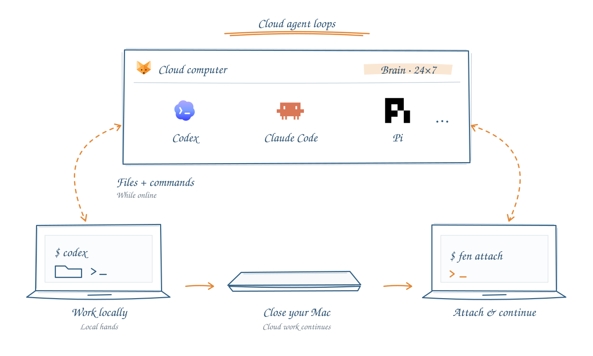

<p align="center">
  
</p>

<h1 align="center">Fennec</h1>
<h3 align="center">Run your coding agents in the cloud, connected to your Mac.</h3>

<p align="center">English · <a href="docs/README_ZH.md" lang="zh-CN">简体中文</a></p>

<p align="center">
  <a href="#meet-fennec"></a>
  <a href="#get-started"></a>
  <a href="DEVELOP.md"></a>
  <a href="DEVELOP.md"></a>
  <a href="https://runta.com/"></a>
</p>

<p align="center"><strong><a href="#meet-fennec">Meet Fennec</a> · <a href="#get-started">Get started</a> · <a href="#meet-fen">The fen CLI</a> · <a href="https://github.com/runta-dev/fennec/issues">Feedback</a></strong></p>

<p align="center"></p>

## Meet Fennec

Fennec runs the agent loop on a cloud computer while connecting it to approved files and tools on your Mac. Choose where each agent runs, keep using your terminal and favorite tools you already use—like **tmux**, **cmux**, and **Herdr**—and manage its sessions from the menu bar or `fen`.

**Brain in the cloud. Hands on your Mac.** The agent reasons and runs in its cloud session. When it needs your local project, files, or commands, it reaches your Mac through the access you approve.

Cloud sessions can keep working around the clock while their cloud computer is running. Closing your laptop ends its availability as a local tool, not the cloud session. Work that needs your Mac waits until it is reachable again.

<p align="center"></p>

## Get started

1. **Open Fennec** from your menu bar and sign in with your Runta account.
2. **Choose an agent.** Select **Cloud computer** to enable cloud execution.
3. **Open your terminal** and launch that agent as usual—for example, `codex`.
4. **Press Ctrl+C to detach.** Fennec prints the command for that specific session. Run it to return, or run `fen` to choose from your live sessions.

Cloud execution needs a Runta account and model access configured for the agent. Cloud compute and model-provider charges are separate.

Cloud controls are currently available for **Claude Code, Codex, Pi, and Kimi Code**. Other discovered agents are shown as **Coming soon**. Fennec synchronizes supported local model settings and credentials; it doesn't require matching local and cloud CLI versions.

Magpie is optional and **off by default**. Sign in to your agent locally; Fennec copies its supported native credentials into an isolated configuration directory in your cloud sandbox. Enable **Settings → Magpie** only if you want to select cloud models through Magpie. The same setting is available with `fen settings magpie on|off`.

## Meet `fen`

A short command for sessions that stay with you. Start with `fen` to open the live-session picker; you don't need to remember a session ID.

When you detach, the terminal tells you exactly how to return. For a session named `cone-leaf`, the actual message is:

```text
Session detached.
Run fen attach cone-leaf to reattach, or fen to manage sessions.
```

`cone-leaf` is the name assigned to that session, not something you need to invent. Use the name in your own detach message, or copy the attach command from Fennec's Sessions page.

```sh
fen                         # Pick a live session
fen attach cone-leaf        # Reattach to a specific session
fen sessions                # List sessions
fen stop cone-leaf           # Explicitly stop a session
```

| In the session picker | Action |
| --- | --- |
| `↑` / `↓` or `j` / `k` | Select a session |
| `Enter` | Attach |
| `x` | Stop the selected session, with confirmation |
| `r` | Refresh |
| `Esc` or `q` | Leave the picker |

<details>
<summary><strong>More terminal commands</strong></summary>

```sh
fen status                  # Check Fennec's state
fen agents                  # List discovered agents
fen launch codex            # Start a cloud Codex session
fen account                 # Inspect account state
fen billing                 # Inspect account usage
fen --help                  # See available commands
```

Control commands return structured JSON, making them useful in scripts as well as your terminal.

</details>

## Leave and come back

**Ctrl+C detaches your terminal.** The cloud agent keeps running. Closing the Fennec popup also leaves sessions running.

To end a session, use the agent's own exit command—such as `/exit` or Pi's `/quit`—or choose **Stop session** in Fennec.

Cloud execution doesn't move every dependency off your Mac. If a task needs local files, commands, or services through the connector, your Mac must remain reachable for that access. Approve local access only for the work you intend to allow.

<details>
<summary><strong>Attach vs. resume</strong></summary>

`fen attach` connects to an existing live process. For a finished Codex session, `fen resume <session-id>` can restore its saved conversation when Fennec can identify it unambiguously. It starts a new process; it is not a live attachment.

</details>

## Built with you

Found a rough edge? [Open an issue](https://github.com/runta-dev/fennec/issues) with what you expected and what happened. Keep credentials and private terminal output out of public reports.

Want to contribute? See [DEVELOP.md](DEVELOP.md) for architecture, builds, signing, and checks. Third-party assets and licenses are documented in [THIRD_PARTY_NOTICES.md](THIRD_PARTY_NOTICES.md).

---

<div align="center">

**If Fennec makes your terminal feel a little more free, give it a star. ⭐**

Built by [Runta](https://runta.com/) · [Share feedback](https://github.com/runta-dev/fennec/issues)

</div>
