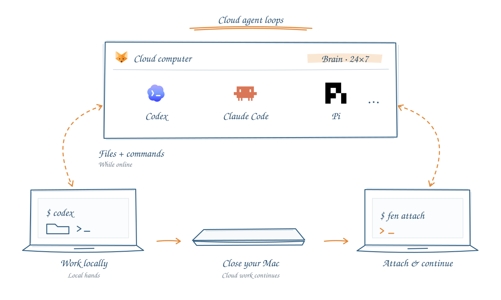

<p align="center">
  
</p>

<h1 align="center">Fennec</h1>
<h3 align="center">让编程代理在云端运行，与你的 Mac 保持连接</h3>

<p align="center"><a href="../README.md" lang="en">English</a> · 简体中文</p>

<p align="center">
  <a href="#认识-fennec"></a>
  <a href="#开始使用"></a>
  <a href="../DEVELOP.md"></a>
  <a href="../DEVELOP.md"></a>
  <a href="https://runta.com/"></a>
</p>

<p align="center"><strong><a href="#认识-fennec">认识 Fennec</a> · <a href="#开始使用">开始使用</a> · <a href="#认识-fen">fen 命令行</a> · <a href="https://github.com/runta-dev/fennec/issues">反馈问题</a></strong></p>

<p align="center"></p>

## 认识 Fennec

Fennec 将编程代理的工作循环放到云电脑上运行，让它按你的授权访问 Mac 上的文件和工具。你可以为每个代理选择运行位置，继续使用熟悉的终端，以及 **tmux、cmux、Herdr** 等工具，再通过菜单栏或 `fen` 管理会话。

**大脑在云端，双手在 Mac。** 代理在云端会话中思考、执行任务；需要本地项目、文件或命令时，再通过你授权的访问通道连接 Mac。

只要云电脑仍在运行，云端会话就可以持续工作。合上笔记本后，Mac 暂时无法提供本地工具，但云端会话不会因此结束。需要访问 Mac 的工作，会等它重新上线后再继续。

### 沿用你喜欢的工具

保留 **tmux、cmux、Herdr** 和现有终端工作流，同时获得持久运行的云端会话，以及经授权的本地工具访问能力。

### 继续使用本地项目

编辑器、代码仓库和开发工具都可以留在 Mac 上。为代理选择 **Cloud computer**，让它在云端运行，再按需授权它访问本地文件和执行命令。

### 放心离开，让任务继续

任务在云端具备所需条件后，你可以断开终端、合上笔记本，甚至关闭 Mac。云端工作会继续运行；需要本地文件、工具或服务的部分，则等待 Mac 恢复连接。

### 你的 Mac，你来做主

**Governance / Sandbox（权限管理与沙箱）** 将沙箱内的写入限制在允许的目录，并阻止直接访问受保护的凭据、SSH 密钥和钥匙串数据。让代理放手工作，也让本地访问有明确的边界。

三种权限模式，让你决定授予多少自主权：

- **Ask for approval（请求批准）**：超出沙箱范围的访问，以及强制删除文件等危险命令，需要你的授权。
- **Approve for me（代我审批）**：将审批交给自动审查，同时保留沙箱边界。
- **Full access（完全访问）**：由你主动开启，解除沙箱限制。

### 随时回来，接着工作

重新运行 `fen`，选择原来的会话，就能查看输出、回答代理的问题，或继续在自己的终端里工作。

### 随时掌握代理状态

在菜单栏查看会话的 **Idle（空闲）**、**Working（工作中）**、**Needs input（等待输入）** 和 **Errored（出错）** 状态。你可以复制连接命令，也可以明确停止不再需要的任务。

## 开始使用

1. **从菜单栏打开 Fennec**，登录你的 Runta 账户。
2. **选择一个代理**，将运行位置设为 **Cloud computer**，启用云端执行。
3. **打开终端**，像往常一样启动代理，例如运行 `codex`。
4. **按 Ctrl+C 断开终端**。Fennec 会显示当前会话的重新连接命令。执行该命令即可回来，也可以运行 `fen` 从正在运行的会话中选择。

云端执行需要 Runta 账户，以及为代理配置好的模型访问权限。**云计算费用与模型服务商费用分开计算。**

目前支持云端控制的代理包括 **Claude Code、Codex、Pi、Kimi Code、Cursor CLI 和 Grok Build**。其他已发现的代理会显示为 **Coming soon（即将支持）**。Fennec 会同步受支持的本地模型设置和凭据，无需本地与云端 CLI 使用完全相同的版本。

Cursor CLI 使用 `cursor-agent`，Grok Build 使用 `grok`；Fennec 不接管 Cursor 编辑器的 `cursor` 命令或共用的 `agent` 别名。即使为其他代理开启了 Magpie，这两种 CLI 也会使用各自的原生账号。可以从代理卡片登录，也可以运行 `fen agent login cursor` 或 `fen agent login grok`，并在 CLI 内通过 `/model` 或 `--model` 选择模型。

Magpie 是可选功能，**默认关闭**。先在本地登录代理，Fennec 会把受支持的原生凭据同步到云端沙箱中的隔离配置目录。只有需要通过 Magpie 选择云端模型时，才需启用 **Settings → Magpie**；也可以使用 `fen settings magpie on|off` 调整同一设置。

## 认识 `fen`

用一个简短的命令，管理持续运行的会话。直接运行 `fen` 即可打开会话选择器，不用记住会话 ID。

断开终端时，Fennec 会告诉你如何重新连接。例如，一个名为 `cone-leaf` 的会话会显示：

```text
Session detached.
Run fen attach cone-leaf to reattach, or fen to manage sessions.
```

这表示终端已经断开，你可以运行 `fen attach cone-leaf` 重新连接，也可以运行 `fen` 管理会话。`cone-leaf` 是分配给该会话的名称，不需要自己编造。请使用你实际看到的会话名，或从 Fennec 的 Sessions 页面复制连接命令。

```sh
fen                         # 选择正在运行的会话
fen attach cone-leaf        # 重新连接指定会话
fen sessions                # 列出会话
fen stop cone-leaf          # 明确停止指定会话
```

| 会话选择器中的按键 | 操作 |
| --- | --- |
| `↑` / `↓` 或 `j` / `k` | 选择会话 |
| `Enter` | 连接会话 |
| `x` | 确认后停止选中的会话 |
| `r` | 刷新列表 |
| `Esc` 或 `q` | 退出选择器 |

<details>
<summary><strong>更多终端命令</strong></summary>

```sh
fen status                  # 查看 Fennec 状态
fen agents                  # 列出已发现的代理
fen launch codex            # 启动云端 Codex 会话
fen account                 # 查看账户状态
fen billing                 # 查看账户用量
fen --help                  # 查看可用命令
```

控制命令返回结构化 JSON，既适合在终端中使用，也方便接入脚本。

</details>

## 离开，再回来

**Ctrl+C 只会断开当前终端，云端代理仍会继续运行。** 关闭 Fennec 弹出窗口，也不会结束会话。

要真正结束会话，请使用代理自己的退出命令，例如 `/exit` 或 Pi 的 `/quit`，也可以在 Fennec 中选择 **Stop session（停止会话）**。

云端执行并不意味着任务完全不再依赖 Mac。如果任务需要通过连接器访问本地文件、执行命令或使用本地服务，Mac 就必须保持可连接状态。请只为你希望代理执行的工作授予本地访问权限。

<details>
<summary><strong>attach 与 resume 有什么区别？</strong></summary>

`fen attach` 连接的是仍在运行的进程。对于已经结束的 Codex 会话，当 Fennec 能明确识别保存的对话时，`fen resume <session-id>` 可以恢复它。恢复会启动一个新进程，与重新连接仍在运行的会话不同。

</details>

## 一起完善 Fennec

遇到问题？欢迎[提交 Issue](https://github.com/runta-dev/fennec/issues)，说明你期望的行为和实际发生的情况。请勿在公开报告中包含凭据或私密的终端输出。

想参与开发？请查看 [DEVELOP.md](../DEVELOP.md)，了解架构、构建、签名与检查流程。第三方资源及许可信息见 [THIRD_PARTY_NOTICES.md](../THIRD_PARTY_NOTICES.md)。

---

<div align="center">

**如果 Fennec 让你的终端更自由，欢迎给项目点一颗 Star。⭐**

由 [Runta](https://runta.com/) 构建 · [反馈问题](https://github.com/runta-dev/fennec/issues)

</div>
